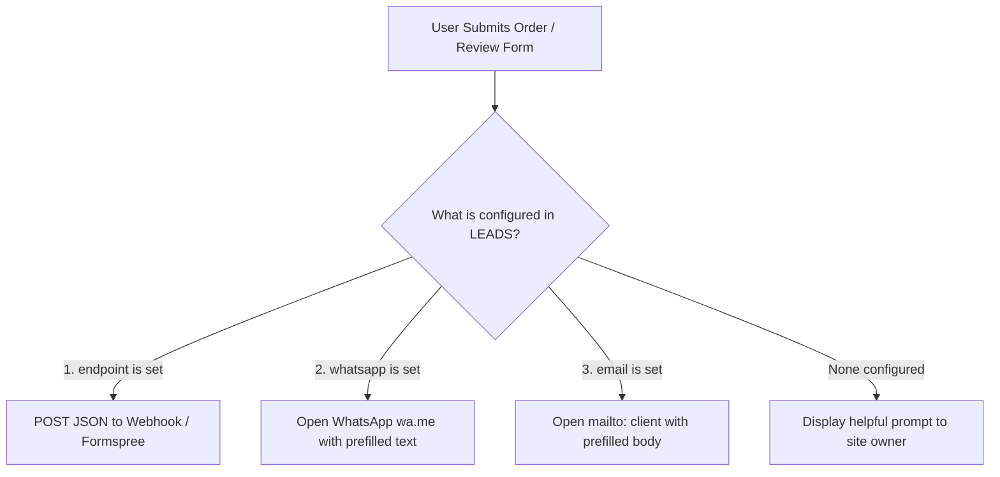

# 🍱 Tiffexx — Marketing Website

> **Ghar ka khana, full swag.**  
> A high-performance, animation-rich, 3D-powered landing page for Tiffexx — delivering authentic, home-style Indian tiffins (thalis) across Ghaziabad, Noida, and Greater Noida.

[](https://vitejs.dev/)
[](https://react.dev/)
[](https://threejs.org/)
[](https://docs.pmnd.rs/react-three-fiber/)
[](https://gsap.com/)
[](https://lenis.darkroom.engineering/)
[](https://motion.dev/)

---

## 📑 Table of Contents
1. [Overview](#-overview)
2. [Complete Tech Stack](#-complete-tech-stack)
3. [Architecture & How the Page Works](#-architecture--how-the-page-works)
   - [1. Preloader & Intro Sequence](#1-preloader--intro-sequence)
   - [2. Dual-Panel Curtain Page Transition](#2-dual-panel-curtain-page-transition)
   - [3. Smart Navigation Header](#3-smart-navigation-header)
   - [4. Hero & 3D Procedural Tiffin Scroll Story](#4-hero--3d-procedural-tiffin-scroll-story)
   - [5. Velocity-Sensitive Crossed Marquee](#5-velocity-sensitive-crossed-marquee)
   - [6. The Mascot Crew & 3D Tilt Cards](#6-the-mascot-crew--3d-tilt-cards)
   - [7. SVG Motion-Path Delivery Tracker](#7-svg-motion-path-delivery-tracker)
   - [8. Interactive Service Areas & Delivery Checker](#8-interactive-service-areas--delivery-checker)
   - [9. Adaptive Reviews System & Submission Modal](#9-adaptive-reviews-system--submission-modal)
   - [10. Animated FAQ Accordion](#10-animated-faq-accordion)
   - [11. Order & Lead Capture Pipeline](#11-order--lead-capture-pipeline)
   - [12. Typographic Footer](#12-typographic-footer)
4. [3D Engineering Deep Dive (TiffinScene)](#-3d-engineering-deep-dive-tiffenscene)
5. [Lead Generation Pipeline](#-lead-generation-pipeline)
6. [Business Configuration Guide (`src/content.js`)](#-business-configuration-guide-srccontentjs)
7. [Accessibility & Performance Engineering](#-accessibility--performance-engineering)
8. [Directory Structure](#-directory-structure)
9. [Local Development & Deployment](#-local-development--deployment)

---

## 🌟 Overview

The **Tiffexx Marketing Website** is an interactive, conversion-focused single-page application crafted with agency-grade visual design and creative web development techniques. It blends vibrant Indian street swagger with modern typography, smooth physics-driven scrolling, and a **fully procedural 3D tiffin carrier** that unstacks layer-by-layer as the user scrolls.

### Key Highlights
- **100% Procedural 3D Tiffin**: No bulky `.gltf` or `.obj` 3D files to download. Geometry, textures, and food elements are generated purely with Three.js math and procedural Canvas textures for near-instant load times.
- **Scroll-Synchronized Storytelling**: GSAP ScrollTrigger and Lenis smooth scrolling orchestrate the mechanical opening of the tiffin carrier, revealing individual thali dishes (Rice, Dal, Sabzi, Paneer, Roti + Sweet).
- **Flexible Lead Management**: Zero backend required to run. Order requests and customer reviews route seamlessly to any JSON webhook (e.g., Formspree), direct WhatsApp chat (`wa.me`), or pre-filled email.
- **Resilient & Accessible**: Fully responsive across mobile, tablet, and ultra-wide desktops. Includes automatic fallback to 2D mascot illustrations if WebGL is unavailable and honors `prefers-reduced-motion`.

---

## 🛠 Complete Tech Stack

| Category | Technology | Version | Purpose & Implementation Details |
| :--- | :--- | :--- | :--- |
| **Core Framework** | **React** | `^18.3.1` | Component-driven UI, state management, concurrent rendering features, and dynamic lazy-loading via `Suspense`. |
| **Build Tooling** | **Vite** | `^5.4.10` | Fast HMR dev server, Rollup static bundle optimization, tree-shaking, and modern ES module delivery. |
| **3D Graphics** | **Three.js** | `^0.169.0` | Core WebGL engine: `LatheGeometry` for tiffin tins, `InstancedMesh` for scattered grains, PBR physical materials with clearcoat, and studio lighting via `RoomEnvironment`. |
| **React 3D Renderer** | **React Three Fiber (R3F)** | `^8.17.10` | Declarative Three.js scene graph in React, render loops with `useFrame`, and responsive canvas scaling. |
| **Scroll Animation** | **GSAP (GreenSock)** | `^3.12.5` | Timeline animations, text reveals, parallax layers, and hardware-accelerated transforms. |
| **Scroll Engine** | **GSAP ScrollTrigger** | `^3.12.5` | Scroll progress tracking, pinning sticky stages, scrubbed timelines, and velocity detection. |
| **Path Animation** | **GSAP MotionPathPlugin** | `^3.12.5` | Calculates SVG path coordinates to animate the delivery runner along the route. |
| **Smooth Scrolling** | **Lenis** | `^1.1.14` | High-performance virtual smooth scrolling synchronized with the GSAP ticker (`lagSmoothing(0)`). |
| **Component Motion** | **Motion (Framer Motion)**| `^11.11.17` | Layout transitions, `<AnimatePresence>` for accordion expand/collapse, modals, and radio pill animations. |
| **Typography** | **Fontsource Variable** | `^5.3.0` | Self-hosted web fonts for maximum speed and zero external font tracking: <br>• **Bricolage Grotesque Variable** (Bold headlines)<br>• **Manrope Variable** (Clean, legible body copy)<br>• **Kalam** (Authentic handwritten Hindi-English notes) |
| **Styling** | **Bespoke Vanilla CSS** | CSS3 | Custom design system (`main.css`) with CSS custom properties, fluid typography using `clamp()`, and glassmorphic blurs. |

---

## 🏗 Architecture & How the Page Works

The application runs as a cohesive, single-page interactive experience structured into specialized components:

```
[ Preloader (0% → 100% Asset & Font Readiness) ]
                     ↓
[ Curtain Transition (Yellow & Maroon Panels) ]
                     ↓
┌────────────────────────────────────────────────────────┐
│ Sticky Story Stage:                                    │
│   • Hero (Headlines + Floating Mascots)                │
│   • 3D Tiffin Carrier Unstacking on Scroll (5 Tiers)   │
│   • "What's Inside" Thali Dish Breakdown               │
└────────────────────────────────────────────────────────┘
                     ↓
[ Crossed Velocity-Reactive Marquee ]
                     ↓
[ About: Mascot Crew & 3D Pointer-Tilt Cards ]
                     ↓
[ How It Works: SVG Motion-Path Delivery Animation ]
                     ↓
[ Areas: 3D Isometric Map & Instant Locality Checker ]
                     ↓
[ Reviews: Live Testimonials / Adaptive Empty State ]
                     ↓
[ FAQ: Animated Accordion with Parallax Mascot ]
                     ↓
[ Order: Validation-Gated Lead Generation Form ]
                     ↓
[ Footer: Mega Typographic Brand Signoff & Jump Links ]
```

---

### 1. Preloader & Intro Sequence
**File**: [`src/components/Preloader.jsx`](file:///c:/Users/Lenovo/Downloads/tiffexx-website/tiffexx/src/components/Preloader.jsx)

- **Execution**: When the visitor opens the page, a full-screen brand overlay with a split color panel (Yellow & Maroon) engages.
- **Counter & Readiness**: Tracks font rendering via `document.fonts.ready` and image loading via `document.readyState === 'complete'`. An animated counter increments from `0%` to `100%`.
- **Exit Motion**: Once loaded, the Tiffexx logo and mascots retract, and the two background panels wipe upward (`yPercent: -100`) with an `expo.inOut` ease to reveal the hero section.

---

### 2. Dual-Panel Curtain Page Transition
**File**: [`src/components/Curtain.jsx`](file:///c:/Users/Lenovo/Downloads/tiffexx-website/tiffexx/src/components/Curtain.jsx)

- **Smooth Section Jumping**: Standard anchor jumping (`#faq`, `#order`) can feel abrupt. Tiffexx introduces an in-page curtain wipe.
- **Event-Driven**: Triggered globally via custom DOM event `tx:go`:
  ```javascript
  window.dispatchEvent(new CustomEvent('tx:go', { detail: '#order' }))
  ```
- **Sequence**: Two curved brand panels slide across the screen to cover the viewport. While hidden, the page instantaneously jumps to the target section and manages accessibility focus, then wipes away.

---

### 3. Smart Navigation Header
**File**: [`src/components/Nav.jsx`](file:///c:/Users/Lenovo/Downloads/tiffexx-website/tiffexx/src/components/Nav.jsx)

- **Scroll-Aware Visibility**: Stays transparent at the top, adds a frosted blur backdrop when scrolling past `40px`, and automatically tucks out of view when scrolling down past `400px` (re-appearing instantly on upward scroll).
- **Accessibility**: Includes a dedicated "Skip to order form" skip-link for keyboard users.
- **Mobile Menu Drawer**: Fullscreen animated overlay with built-in Tab focus trapping and `Escape` key listeners.

---

### 4. Hero & 3D Procedural Tiffin Scroll Story
**Files**: [`src/components/Story.jsx`](file:///c:/Users/Lenovo/Downloads/tiffexx-website/tiffexx/src/components/Story.jsx), [`src/three/TiffinScene.jsx`](file:///c:/Users/Lenovo/Downloads/tiffexx-website/tiffexx/src/three/TiffinScene.jsx)

The centerpiece of the entire website. The hero and "What's inside" section share a single, sticky WebGL stage:

1. **Hero State**:
   - The closed 5-tier Indian tiffin carrier floats gently in 3D space with an idle breathing bob.
   - Mouse move listeners track cursor coordinates to tilt the carrier in 3D perspective and shift the mascot rice bowl in opposing parallax.
2. **Scroll-Driven Unstacking (`0%` → `100%` Scroll Progress)**:
   - As the user scrolls down, the hero text fades and moves out.
   - The steel latch of the tiffin unclasps, the domed lid lifts upward, and the five enamel containers separate vertically along the Y-axis.
   - Each tier reveals its authentic meal contents:
     - **Top Tier**: Soft folded Rotis with charred spots + sweet Gulab Jamun.
     - **Tier 4**: Golden-brown Paneer cubes resting in rich tomato gravy.
     - **Tier 3**: Seasonal vegetable Sabzi seasoned with spices.
     - **Tier 2**: Simmered Dal with tempered mustard seeds and coriander leaves.
     - **Bottom Tier**: Fluffy individual grains of Basmati Rice.
3. **Synchronized Story Cards**:
   - As each tier opens, the active section highlights the dish name in English and Hindi script, accompanied by its tasting notes.
4. **Adaptive Fallback**:
   - If WebGL is not supported on the visitor's device, or if `prefers-reduced-motion` is enabled, the site automatically switches to high-resolution 2D mascot artwork.

---

### 5. Velocity-Sensitive Crossed Marquee
**File**: [`src/components/Marquee.jsx`](file:///c:/Users/Lenovo/Downloads/tiffexx-website/tiffexx/src/components/Marquee.jsx)

- Two crossed ticker bands displaying menu essentials: *Dal, Sabzi, Paneer, Chawal, Roti, Meetha, Ghar ka khana*.
- Uses `ScrollTrigger.getVelocity()` to dynamically calculate scroll speed:
  - Scrolling faster speeds up the marquee ticker.
  - Scrolling upward reverses the ticker direction in real time.
  - Once scrolling stops, a delayed call smoothly eases the ticker back to normal cruise speed.

---

### 6. The Mascot Crew & 3D Tilt Cards
**File**: [`src/components/About.jsx`](file:///c:/Users/Lenovo/Downloads/tiffexx-website/tiffexx/src/components/About.jsx)

- Introduces the brand mascots:
  - **The Full Thali** (*"Sab kuch, ek saath."*)
  - **Chill Chawal** (*"Cool rehne ka."*)
  - **Roti Rockstar** (*"Garam hai, sambhal ke!"*)
- **Interactive 3D Spring Tilt**: Moving the pointer across any mascot card calculates cursor offsets from center and tilts the card frame (`rotateX`, `rotateY`) while translating the mascot image outward for a dynamic pseudo-3D pop-out effect. On cursor leave, GSAP snaps the card back with an `elastic.out` bounce.
- **Dynamic Lede**: Cycles through target customer personas every 1.9 seconds (*desk lunches, hostel dinners, PG nights, late shifts, busy homes*).

---

### 7. SVG Motion-Path Delivery Tracker
**File**: [`src/components/HowItWorks.jsx`](file:///c:/Users/Lenovo/Downloads/tiffexx-website/tiffexx/src/components/HowItWorks.jsx)

- Three clear steps: **1. Tell us** → **2. We pack** → **3. You eat**.
- Uses an SVG route curve combined with **GSAP MotionPathPlugin**:
  - As the user scrolls through the section, the dashed route path draws itself via `strokeDashoffset`.
  - The delivery runner mascot physically travels along the curved SVG path, aligned to its angles.
  - Features responsive path coordinates for both desktop and mobile layouts using `gsap.matchMedia()`.

---

### 8. Interactive Service Areas & Delivery Checker
**File**: [`src/components/Areas.jsx`](file:///c:/Users/Lenovo/Downloads/tiffexx-website/tiffexx/src/components/Areas.jsx)

- Displays an isometric 3D tilted map of the service zone: **Ghaziabad**, **Noida**, and **Greater Noida**.
- **Interactive Map Pins**: Pulsing pins positioned with percentage coordinates (`x%`, `y%`). Clicking a pin highlights the region.
- **Live Locality Search**: Visitors can type their locality or sector. The engine validates against the delivery matrix and gives immediate feedback.
- **Seamless Lead Pass**: Clicking "Order to this area" fires the `tx:area` event, pre-populating the order form below and scrolling straight to it.

---

### 9. Adaptive Reviews System & Submission Modal
**File**: [`src/components/Reviews.jsx`](file:///c:/Users/Lenovo/Downloads/tiffexx-website/tiffexx/src/components/Reviews.jsx)

- **Honest "Day Zero" Design**: If the `REVIEWS` array in `content.js` is empty, rather than fabricating fake reviews, the section renders an animated typewriter headline: *"Your review could be the first one here."*
- **Live Review Cards**: Once reviews are added to `content.js`, it renders styled testimonial cards with customer names, areas, and quotes.
- **Interactive Review Modal**: An accessible modal dialog with backdrop blur, scroll locking, and escape-key handling allows customers to submit real-time reviews directly to the business.

---

### 10. Animated FAQ Accordion
**File**: [`src/components/FAQ.jsx`](file:///c:/Users/Lenovo/Downloads/tiffexx-website/tiffexx/src/components/FAQ.jsx)

- Frequently asked questions answering delivery timings, menu variety, pricing, and dietary preferences.
- Uses **Motion (Framer Motion)** `<AnimatePresence>` for physics-based height and opacity transitions without layout jumps.
- Includes a floating mascot with scroll-linked parallax in the left column.

---

### 11. Order & Lead Capture Pipeline
**File**: [`src/components/Order.jsx`](file:///c:/Users/Lenovo/Downloads/tiffexx-website/tiffexx/src/components/Order.jsx)

- **User Choices**:
  - Meal selection: *Lunch*, *Dinner*, *Both*.
  - Frequency: *Just once*, *A few days a week*, *Every weekday*, *Not sure yet*.
- **Client-Side Validation**:
  - Requires customer name and exact locality.
  - Validates Indian 10-digit mobile numbers with regex: `/^(\+?91[\s-]?)?[6-9]\d{4}[\s-]?\d{5}$/`.
- **Dynamic Multi-Channel Dispatcher**: Handled by [`src/lib/leads.js`](file:///c:/Users/Lenovo/Downloads/tiffexx-website/tiffexx/src/lib/leads.js) (see detailed section below).

---

### 12. Typographic Footer
**File**: [`src/components/Footer.jsx`](file:///c:/Users/Lenovo/Downloads/tiffexx-website/tiffexx/src/components/Footer.jsx)

- Features gigantic architectural letterforms spelling **TIFFEXX** with staggered hover lifts.
- Links to social channels, telephone, email, and interactive back-to-top smooth scrolling.

---

## 🎨 3D Engineering Deep Dive (`TiffinScene`)

The 3D tiffin in [`src/three/TiffinScene.jsx`](file:///c:/Users/Lenovo/Downloads/tiffexx-website/tiffexx/src/three/TiffinScene.jsx) contains zero external geometry files. Everything is synthesized using Three.js mathematical primitives:

```
                  ┌─────────┐
                  │ Domed   │  ← LatheGeometry with steel handle & latches
                  │ Lid     │
             ┌────┴─────────┴────┐
             │ 5. Roti & Sweet   │  ← Canvas-textured charred discs + glossy spheres
             ├───────────────────┤
             │ 4. Paneer Tikka   │  ← Instanced golden BoxGeometries in gravy
             ├───────────────────┤
             │ 3. Seasonal Sabzi │  ← Dodecahedrons & cylinder vegetable chunks
             ├───────────────────┤
             │ 2. Tadka Dal      │  ← Glossy plane with mustard seeds & coriander leaves
             ├───────────────────┤
             │ 1. Fluffy Rice    │  ← Scatter-instanced rice grain capsules
             └───────────────────┘
```

1. **Tier Enamel Bodies**: Generated using `THREE.LatheGeometry` by rotating a 10-point cross-section profile around the central axis, producing authentic rolled rims and nesting bases.
2. **PBR Materials**: Applied with `THREE.MeshPhysicalMaterial` featuring custom roughness, metalness, and clearcoat highlights that react to a simulated 3D `RoomEnvironment`.
3. **Food Item Synthesis**:
   - **Rice**: Hundreds of instanced mini capsules distributed with deterministic pseudo-random seeds (`rand(seed)`) to render in a single GPU draw call.
   - **Dal & Tadka**: A rich yellow liquid mesh topped with instanced dark mustard seeds and green coriander leaf meshes.
   - **Paneer**: Golden-brown cuboids slightly submerged in a spiced curry plane.
   - **Roti**: An HTML5 2D canvas is procedurally painted with radial charcoal-brown gradients to simulate tandoor charring, converted into a `THREE.CanvasTexture`.
4. **Scroll Unstacking Physics**: As scroll progress advances from `0.0` to `1.0`, smoothstep curves (`sstep`) calculate individual Y-offsets and rotation for each tier, creating a floating explosion diagram.

---

## 📬 Lead Generation Pipeline

Lead submission in [`src/lib/leads.js`](file:///c:/Users/Lenovo/Downloads/tiffexx-website/tiffexx/src/lib/leads.js) supports three zero-maintenance channels configured in `src/content.js`:



### 1. Webhook Endpoint (Recommended for automated CRM)
If `LEADS.endpoint` is set (e.g., Formspree, Formkeep, Zapier, Make):
- Sends a `POST` request with JSON headers containing:
  ```json
  {
    "kind": "order",
    "name": "Aarav Sharma",
    "phone": "9876543210",
    "area": "Noida",
    "locality": "Sector 62",
    "meal": "Lunch",
    "frequency": "Every weekday",
    "notes": "Less spicy please",
    "submittedAt": "2026-10-16T10:00:00.000Z",
    "page": "https://tiffexx.com/"
  }
  ```

### 2. WhatsApp Direct Link
If `LEADS.whatsapp` is filled (e.g., `'919876543210'`):
- Automatically opens WhatsApp with an encoded message:
  ```text
  Hi Tiffexx! I’d like a tiffin.
  Name: Aarav Sharma
  Phone: 9876543210
  Area: Noida
  Locality: Sector 62
  Meal: Lunch
  How often: Every weekday
  Notes: Less spicy please
  ```

### 3. Email Direct Link
If `LEADS.email` is filled (e.g., `'orders@tiffexx.com'`):
- Launches visitor's mail client with subject and structured body.

---

## ⚙️ Business Configuration Guide (`src/content.js`)

All business information is decoupled from UI code and managed inside [`src/content.js`](file:///c:/Users/Lenovo/Downloads/tiffexx-website/tiffexx/src/content.js).

### 1. Connect Leads
```javascript
export const LEADS = {
  // Option A: Formspree or custom API
  endpoint: 'https://formspree.io/f/your_form_id',
  // Option B: WhatsApp number with country code (no + or spaces)
  whatsapp: '919876543210',
  // Option C: Email address
  email: 'hello@tiffexx.com',
}
```

### 2. Public Contact Details (Displayed in Footer)
```javascript
export const CONTACT = {
  phone: '+91 98765 43210',
  email: 'contact@tiffexx.com',
  instagram: 'https://instagram.com/tiffexx',
}
```

### 3. Service Areas & Map Pins
```javascript
export const AREAS = [
  { id: 'ghaziabad', name: 'Ghaziabad', x: 23.9, y: 34.5 },
  { id: 'noida', name: 'Noida', x: 46.1, y: 64.5 },
  { id: 'greater-noida', name: 'Greater Noida', x: 77.4, y: 47.5 },
]
```

### 4. Adding Customer Reviews
```javascript
export const REVIEWS = [
  {
    name: 'Pooja Verma',
    area: 'Noida Sector 62',
    text: 'Proper ghar ka khana. The dal tadka tastes just like mom makes it!',
    source: 'Google',
  },
]
```

---

## ♿ Accessibility & Performance Engineering

- **Reduced Motion Support**: Strictly honors `prefers-reduced-motion: reduce`. Automatically disables virtual smooth scrolling, skips preloader animations, silences 3D tilt interactions, and swaps scrubbed timelines to direct cuts.
- **Screen Reader Support**:
  - The [`Split.jsx`](file:///c:/Users/Lenovo/Downloads/tiffexx-website/tiffexx/src/components/Split.jsx) component breaks headlines into masked characters for GSAP animations while preserving a clean, un-split string in `aria-label`.
  - Mascots use `aria-hidden="true"` when used decoratively.
  - Forms use `aria-invalid` and `aria-describedby` linked to validation error IDs.
- **Asset Optimization**:
  - Mascots and maps are served in next-gen **WebP** formats with responsive `srcset` and `sizes` attributes.
  - Critical brand assets (`tiffexx-logo.png`, `mascot-rice-sm.webp`) are preloaded in `index.html`.
  - Self-hosted variable fonts avoid external Google CDN roundtrips.

---

## 📁 Directory Structure

```text
tiffexx/
├── public/
│   ├── assets/
│   │   ├── mascot-rice.webp         # Full-res cut-out mascot
│   │   ├── mascot-rice-sm.webp      # Responsive mobile mascot
│   │   ├── mascot-roti.webp
│   │   ├── mascot-roti-sm.webp
│   │   ├── mascot-thali.webp
│   │   ├── mascot-thali-sm.webp
│   │   ├── service-map.webp         # NCR delivery map artwork
│   │   ├── service-map-sm.webp
│   │   ├── tiffexx-logo.png         # High-resolution brand logo
│   │   └── og-image.jpg             # OpenGraph share banner
│   └── favicon.svg                  # Brand favicon
├── src/
│   ├── components/
│   │   ├── About.jsx                # Mascot character cards with 3D tilt
│   │   ├── Areas.jsx                # 3D tilted map with pin points & search
│   │   ├── Curtain.jsx              # Custom page transition curtain
│   │   ├── FAQ.jsx                  # Accordion with Framer Motion
│   │   ├── Footer.jsx               # Huge typography footer & links
│   │   ├── HowItWorks.jsx           # SVG motion-path animated timeline
│   │   ├── Marquee.jsx              # Velocity-reactive ticker tape
│   │   ├── Mascot.jsx               # Responsive picture/image wrapper
│   │   ├── Nav.jsx                  # Scroll-aware navigation & mobile menu
│   │   ├── Order.jsx                # Order enquiry form with validation
│   │   ├── Preloader.jsx            # 0-100% asset counter & intro wipe
│   │   ├── Reviews.jsx              # Customer reviews / adaptive empty state
│   │   ├── Split.jsx                # Accessible character-splitting for GSAP
│   │   └── Story.jsx                # Sticky hero + 3D unstacking stage
│   ├── lib/
│   │   ├── env.js                   # WebGL detection, reduced-motion, breakpoints
│   │   ├── leads.js                 # Lead dispatching (API / WhatsApp / Mailto)
│   │   ├── reveals.js               # Global GSAP text & reveal observers
│   │   └── scroll.js                # Lenis smooth-scroll & GSAP ScrollTrigger sync
│   ├── styles/
│   │   └── main.css                 # Master design tokens & component styling
│   ├── three/
│   │   └── TiffinScene.jsx          # Procedural 3D tiffin carrier model & scene
│   ├── content.js                   # Central business configuration & copy
│   ├── App.jsx                      # Root application layout
│   └── main.jsx                     # Entry point & font imports
├── index.html                       # HTML shell, metadata, and preloads
├── package.json                     # Dependencies & scripts
└── vite.config.js                   # Vite configuration with React plugin
```

---

## 🚀 Local Development & Deployment

### Prerequisites
- [Node.js](https://nodejs.org/) (version 18.0 or newer recommended)
- `npm` (bundled with Node)

### 1. Installation
Navigate into the `tiffexx` directory and install project dependencies:
```bash
cd tiffexx
npm install
```

### 2. Run Local Development Server
Start Vite's live reload development server:
```bash
npm run dev
```
Open your browser and navigate to **`http://localhost:5173`**.

### 3. Production Build
Compile and bundle the project into optimized, minified static files:
```bash
npm run build
```
The output will be generated in the `dist/` folder.

### 4. Preview Production Build
Test the production bundle locally prior to deployment:
```bash
npm run preview
```

### 5. Deployment Options
The generated `dist/` directory consists of static HTML, CSS, JavaScript, and WebP images. You can deploy it instantly to any static hosting provider:
- **Vercel**: Import repository and set root directory to `tiffexx`, framework preset to `Vite`.
- **Netlify**: Set publish directory to `tiffexx/dist` and build command to `npm run build`.
- **Cloudflare Pages**: Connect repo, set build output directory to `tiffexx/dist`.
- **GitHub Pages**: Build and push `dist/` to your `gh-pages` branch.

---

## 📜 License
Private & Proprietary © Tiffexx. All rights reserved.
